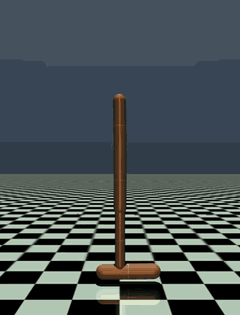

  

  We build open-source infrastructure for machine learning research, from autonomous research agents to training on new accelerators.

  
  
  

## Projects

| | Project | What it does |
|---|---|---|
| 🔬 | [**HypothesisLoop**](https://github.com/scaleresearch/hypothesisloop) | A control plane where teams of LLM agents run ML research autonomously, on your own compute |
| 🎮 | [**tt-rl**](https://github.com/scaleresearch/tt-rl) | Reinforcement learning trained natively on Tenstorrent chips with TT-NN |

---

### 🔬 [HypothesisLoop](https://github.com/scaleresearch/hypothesisloop)

**The control plane for autonomous ML research.** State an objective and the metrics that define success. A team of LLM agents proposes hypotheses, tests each one as a real training job and records every result, so any claim can be traced back to the code and data that produced it.

- **Hypothesis graph:** agents build on the objective and on each other's findings, confirming or refuting each idea with measured jobs
- **Multi-cluster scheduler:** Kubernetes, bare metal and rented compute, across NVIDIA GPUs, Tenstorrent chips, TPUs and CPUs
- **Any workload:** single jobs, sweeps, distributed training, and RL with a learner beside many actors

Agents' hypotheses for one experiment, each confirmed, refuted or still open against a measured baseline.

[Repository](https://github.com/scaleresearch/hypothesisloop) · [Experiment template](https://github.com/scaleresearch/hypothesisloop-experiment-template)

---

### 🎮 [tt-rl](https://github.com/scaleresearch/tt-rl)

**Reinforcement learning on Tenstorrent hardware.** DQN, PPO and SAC written natively on TT-NN. Rollouts, replay and gradient updates run on the chip, and every trained policy exports to ONNX for deployment on a CPU.

<table>
<tr>
<td align="center" width="25%"> <b>Pong</b> <code>17.8</code></td>
<td align="center" width="25%"> <b>Breakout</b> <code>144.8</code></td>
<td align="center" width="25%"> <b>Boxing</b> <code>91.0</code></td>
<td align="center" width="25%"> <b>Hopper</b> <code>3604</code></td>
</tr>
</table>

Each agent trained on a single Blackhole chip.

[Repository](https://github.com/scaleresearch/tt-rl) · [Trained models on Hugging Face](https://huggingface.co/scaleresearch)

---

More projects are on the way. Issues, ideas and pull requests are welcome.

